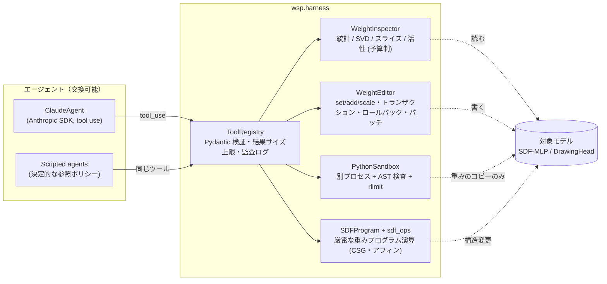

# アーキテクチャ — 重みを「読み書きできるソースコード」として扱うハーネス

## 全体像



設計上の要点は 3 つです。

1. **エージェントはツールを通してしかモデルに触れない。** Claude も scripted エージェントも同じ
   `ToolRegistry` を使うので、「LLM なら何ができるか」をツール集合として明示でき、入力検証・予算・監査ログが
   必ず通ります。
2. **書き込みは常に巻き戻せる。** `WeightEditor.transaction(validate=...)` は検証に失敗するか例外が出れば
   ビット単位で元に戻します。すべての編集は `EditRecord`（何を・どこを・なぜ・どれだけ）として残ります。
3. **LLM が書くコードは隔離して実行し、結果は「提案」に留める。** サンドボックスは重みのコピー（読み取り専用
   numpy 配列）だけを受け取り、`EDITS` に置いたテンソルは親プロセスが `apply_sandbox_edits` で
   トランザクション内に適用して初めて反映されます。

## モジュール

| モジュール | 役割 | 主な API |
|---|---|---|
| `harness/inspector.py` | Read。重みの統計・スペクトル・生値、活性の計測。順伝播はサンプル単位で `ForwardBudget` に課金 | `list_parameters`, `tensor_stats`, `svd`, `read_slice`, `top_k`, `capture`, `activation_stats` |
| `harness/editor.py` | Fix / Write（固定形状）。ガードレール（保護パラメータ、NaN/Inf 拒否、相対変化量上限） | `set/add/scale`, `checkpoint/rollback`, `transaction`, `diff`, `export_patch`, `apply_patch` |
| `harness/sandbox.py` | LLM のコードを `python -I -m wsp.harness._sandbox_worker` で実行 | `PythonSandbox.run(code) -> SandboxResult` |
| `harness/tools.py` | Pydantic で型付けしたツール定義 → Claude API の `tools` スキーマ | `ToolRegistry`, `add_weight_tools`, `add_finish_tool` |
| `geometry/sdf_ops.py` | ReLU SDF ネットワークに対する厳密な重み演算 | `translate`, `affine_input`, `scale_axis`, `offset_surface`, `linear_max`, `prism`, `box`, `compose_max/min`, `subtract`, `union` |
| `agents/snippets/read_sdf.py` | サンドボックスに投入する「重みから部品を読む」コード（numpy のみ） | `read_part(layers)` |
| `agents/llm.py` | Claude のツール使用ループ | `ClaudeAgent.run(task, tools)` |
| `agents/scripted.py` | 参照エージェント（Exp1–3） | `ScriptedReader`, `ScriptedECNEditor`, `ScriptedFixer` |

## 重みプログラム演算（`sdf_ops`）の数学

ネットワーク `f(x) = W_L h_{L-1} + b_L`, `h_i = relu(W_i h_{i-1} + b_i)` に対して:

| 操作 | 等式 | 重みの変更 |
|---|---|---|
| 平行移動 | `g(x) = f(x − t)` | `b_1 ← b_1 − W_1 t` |
| アフィン座標変換 | `g(x) = f(Ax + c)` | `W_1 ← W_1 A`, `b_1 ← W_1 c + b_1` |
| 片軸スケール（基準面固定） | `x'_k = p + (x_k − p)/s` | 上の特殊例 |
| 表面オフセット | `g = f − δ` | `b_L ← b_L − δ` |
| 2 値の最大 | `max(a,b) = ½(a+b) + ½|a−b|` | ReLU 4 個: `relu(±(a+b))`, `relu(±(a−b))` |
| 凸多面体 | `max_k (n_k·x + o_k)` | 最大値ガジェットの二分木（`linear_max`） |
| 穴（円柱） | 正 64 角柱（面積一致、半径誤差 < 0.01 %） | `prism` |
| CSG 差 | `max(f, −g)` | 2 ネットを並列（ブロック対角、深さは恒等 ReLU 対で揃える）→ ガジェットで合成 |

注意: `offset_surface` は `|∇f| = 1`（真の距離場）を仮定します。学習済み SDF はこれを満たさないことがあり
（Exp2 ではフランジ内径で `|∇f| ≈ 0.31`）、そのため ECN エージェントは編集後に必ず再読解し、
期待寸法から外れた穴を CSG で局所的に修復します（verify-and-repair）。

## エージェントループ（Claude）

```
messages = [user(task)]
loop (max_turns):
    resp = client.beta.messages.create(model, system(固定), tools(固定), messages,
                                       output_config={"effort": "high"},
                                       cache_control={"type": "ephemeral"},
                                       betas=["server-side-fallback-2026-07-01"], fallbacks="default")
    refusal → 停止 / pause_turn → 続行
    messages += assistant(resp.content)          # thinking ブロックも含め無加工で追記
    tool_use なし → 終了ツール未呼び出しなら最大 2 回リマインド
    各 tool_use → ToolRegistry.call → tool_result（エラーは is_error=True）を 1 つの user メッセージで返す
    終了ツールが呼ばれたら停止
```

- `system` と `tools` は実行中に変えず、`messages` は追記のみ — プロンプトキャッシュの接頭辞が保たれます。
- `max_tokens` で打ち切られたターンの `tool_use` は入力が途中で切れている可能性があるため実行せず、エラーとして返します。

## セキュリティモデル（サンドボックス）

| 層 | 内容 |
|---|---|
| プロセス分離 | `python -I`（ユーザー site/環境変数 PYTHON* 無視）、作業ディレクトリは一時ディレクトリ |
| 静的検査 | import 許可リスト（numpy, math, json, …）、`open`/`eval`/`exec`/`getattr` 等の禁止、dunder 属性アクセス禁止 |
| 実行時 | 制限付き `__builtins__`、許可リストを強制する import フック、重みは読み取り専用配列 |
| 資源 | `RLIMIT_CPU`, `RLIMIT_AS`, `RLIMIT_FSIZE`、壁時計タイムアウト |
| 環境 | `PATH`/`HOME`/BLAS スレッド数のみ。API キーやプロキシ設定は渡さない（テストで検証） |
| ネットワーク | Python レベルでは socket 等を import 不可。強い隔離が必要な場合は `docker compose run closed-net`（`network_mode: none`） |

これは多層防御であり、悪意あるコードに対する完全なセキュリティ境界ではありません。
信頼できないモデルやプロンプトを扱う場合はコンテナ（さらに gVisor 等）での実行を前提にしてください。

## パッチ形式（`wsp-patch/1`）

`WeightEditor.export_patch(path)` は次の 2 ファイルを出力します。

- `path.npz`: 変更されたテンソルごとに `<name>::idx`（平坦化インデックス）と `<name>::val`（新しい値）
- `path.json`: `base_sha256`（適用先モデルのハッシュ）、`patched_sha256`、変更パラメータ一覧、
  変更率、編集履歴（理由付き）、メタデータ

`apply_patch` は適用前後のハッシュを検証し、別のモデルへの誤適用を拒否します。閉域網へは
このパッチ（Exp3 では約 69 個の値）だけを持ち込めば済みます。
